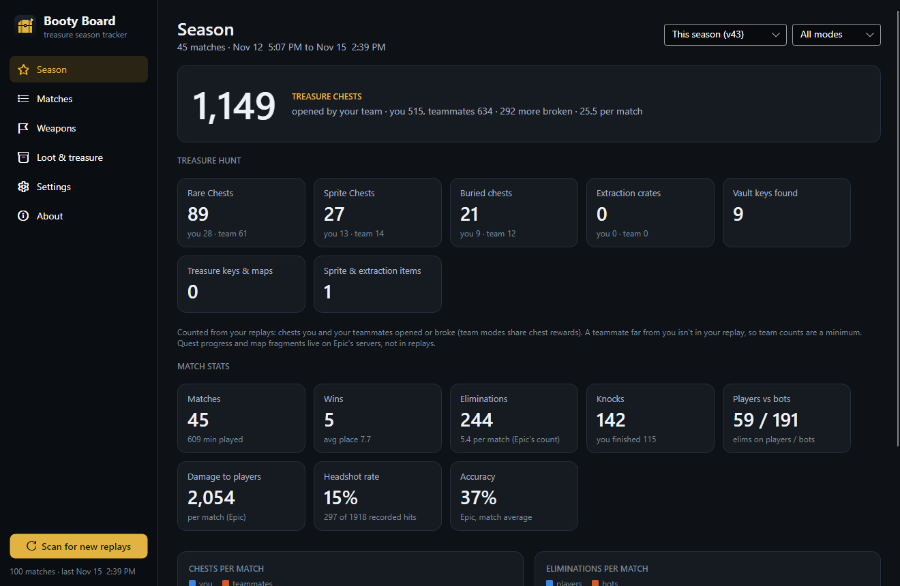
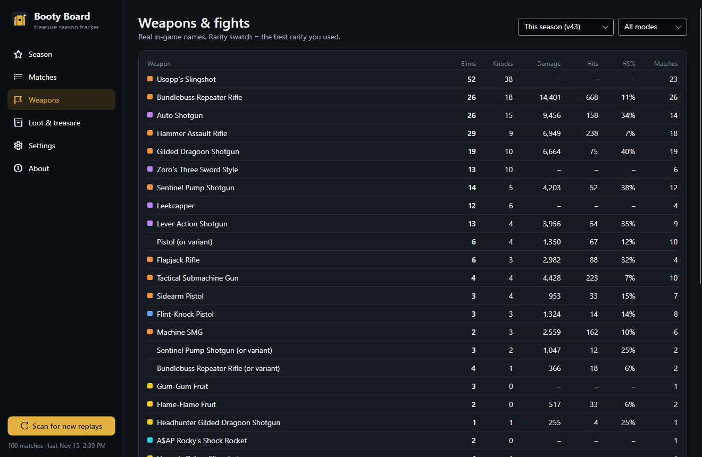
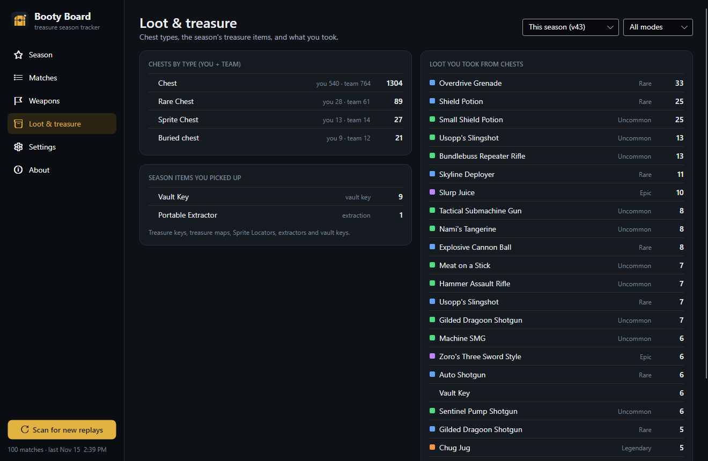

<p align="center"></p>

<h1 align="center">Drop Report</h1>

<p align="center"><b>Treasure-season tracking and the match stats the replay viewer doesn't show, read from your own replay files.</b><br>
Free and open source. Windows. Nothing leaves your PC.</p>



## What it does

Your game saves a replay file after every match. Drop Report reads those files after the match is over and builds:

- **Treasure season**: treasure chests opened by you *and your team* (team modes share chest rewards), Rare Chests,
  Sprite Chests, buried chests, extraction crates, vault keys, treasure keys and maps, Sprite Locators and extractors.
- **Match stats**: wins and placement, eliminations vs knocks (and who finished whose knock), eliminations on players vs
  bots, damage, headshot rate, accuracy, and how you went down (weapon type, distance, bled out or finished).
- **Weapons, with their real in-game names and rarity**: eliminations, knocks, damage, hits and headshot % per weapon.
- **Loot**: what every chest dropped, who took it, and your most-looted items.
- **A playable map of every match, on the real island map**: your and your team's paths, the storm, every chest with a
  loot pop-up, every knock and elimination, and named locations. Scrub, play at 1/4/16x, zoom and pan.

| Match map | Weapons | Loot & treasure |
|---|---|---|
|  |  |  |

## Safe by design

- **Reads files only.** Drop Report reads finished `.replay` files and, for item names, the game's own data files on
  disk. It never reads game memory, never injects anything and never touches the running game, which is what
  anti-cheat looks for.
- **Won't slow your game.** It reads replays at low priority and never while a match is being recorded. It doesn't
  start with Windows and doesn't need admin rights.
- **Private.** No account, no telemetry, no cloud. Your data stays in `%LOCALAPPDATA%\DropReport`. A setting hides other
  players' names for screenshots and streams.

## Install

1. Download `DropReport.exe` from the [latest release](../../releases/latest). It is a single file; no installer, no
   .NET install needed.
2. In the game, make sure replays are on: **Settings > Game > Replays**, record replays for Battle Royale.
3. Run Drop Report. Setup walks you through:
   - **Real item names and the map (optional).** Replays only carry internal code names. Drop Report can read the real
     names, and where the map sits in the world, from your installed game's files. That needs a few small public
     downloads for your game version (a decryption key, a field-layout "mappings" file, the Oodle decompression
     library, and the map image with location names). The setup screen lists each one before anything is fetched.
     Redo it from Settings after a game update.
   - **Import.** It saves a copy of every replay (the game keeps only your last 100) and reads them, about a second
     per match.
4. After you play, hit **Scan for new replays**, or turn on *Watch for new replays while Drop Report is open*.

## What replays can and can't tell you

Drop Report only knows what your replay recorded. Being upfront about the limits:

- **Team chests are a minimum.** A teammate far from you isn't in your replay.
- **Damage totals are partial.** Hits come through in detail for most guns, but slingshot hits arrive blank and melee
  items send none, so recorded damage is usually 50-60% of the game's own total. Headshot rate and per-hit damage are
  reliable. Eliminations and knocks are complete: they come from the game's own elimination events.
- **Quest progress, XP and map fragments aren't in replays.** They live on the game's servers.
- **Item names** come from the game version you built them for. New items show their code name until you update them.

Technical notes on how every number is decoded: [docs/FINDINGS.md](docs/FINDINGS.md).

## Build from source

Needs the .NET 10 SDK.

```
dotnet test
dotnet run --project src/DropReport.App
dotnet run --project src/DropReport.Cli -- analyze <replay file or folder> --out out
dotnet publish src/DropReport.App -c Release -r win-x64 --self-contained -p:PublishSingleFile=true -p:IncludeNativeLibrariesForSelfExtract=true -p:EnableCompressionInSingleFile=true -p:DebugType=none
```

Projects: `DropReport.ReplayReader` (replay reading + analysis; the assembly name must contain "ReplayReader" for the
parser to load its custom export classes), `DropReport.GameData` (item names from game files), `DropReport.App`
(Avalonia UI), `DropReport.Cli`, `tests/DropReport.Tests`.

## Support

Drop Report is free and stays free; nothing is locked behind a payment. If it helps you, you can
[sponsor development on GitHub](https://github.com/sponsors/JoshuaR06).

## Credits & license

MIT licensed. Built on [FortniteReplayReader](https://github.com/Shiqan/FortniteReplayDecompressor) (MIT),
[CUE4Parse](https://github.com/FabianFG/CUE4Parse) (Apache-2.0) and [Avalonia](https://github.com/AvaloniaUI/Avalonia)
(MIT). See [THIRD-PARTY-NOTICES.md](THIRD-PARTY-NOTICES.md).

---

*Portions of the materials used are trademarks and/or copyrighted works of Epic Games, Inc. All rights reserved by
Epic. This material is not official and is not endorsed by Epic.* Drop Report is a fan-made tool and is not affiliated
with Epic Games.
