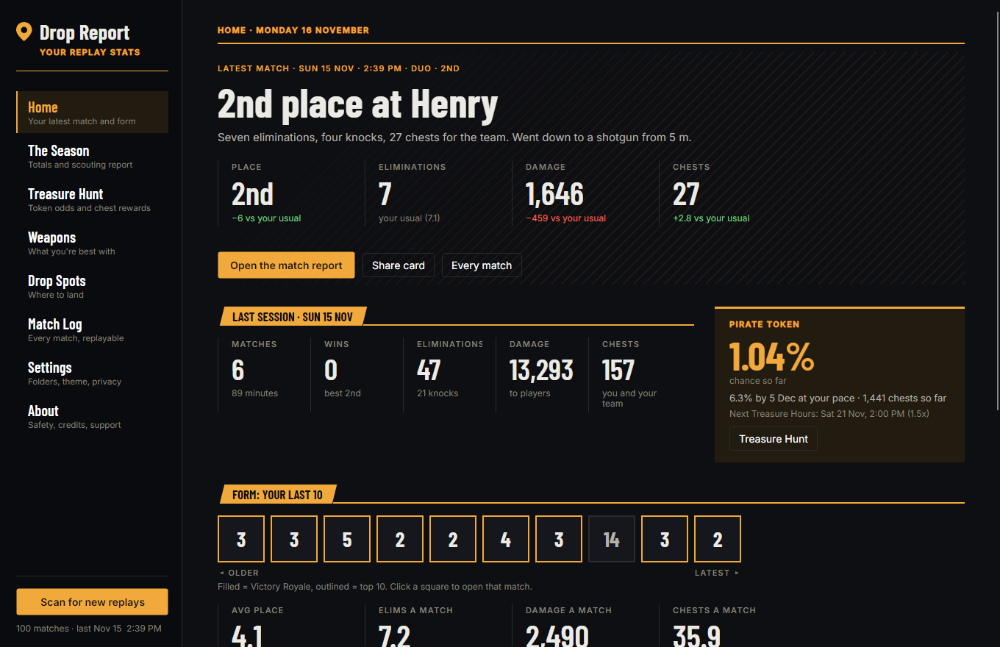
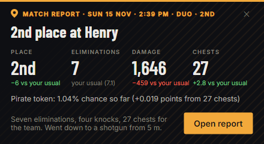
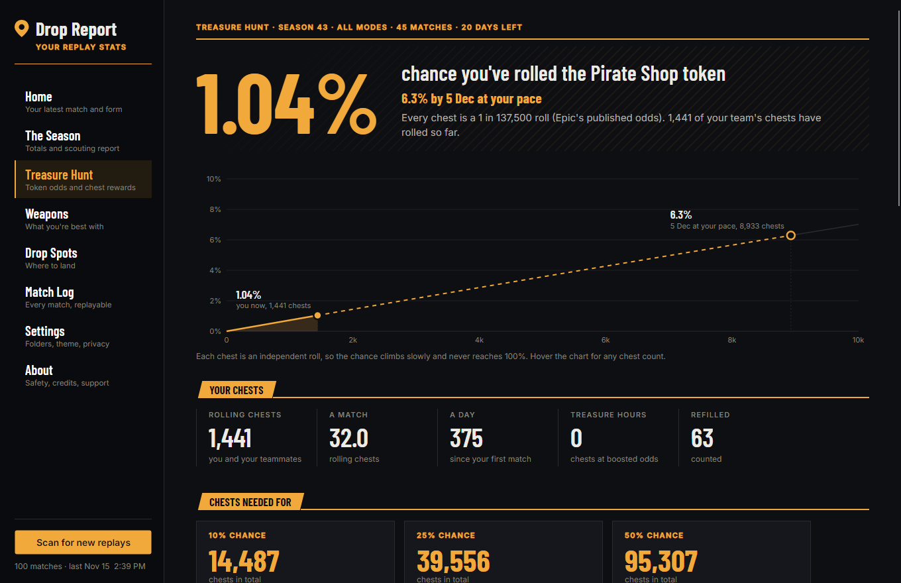
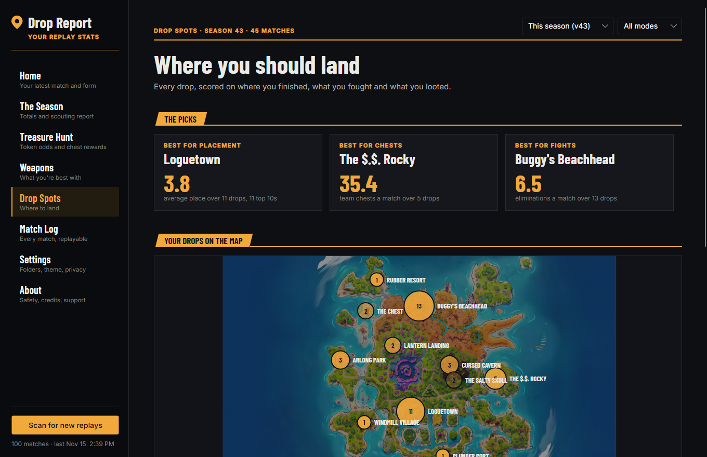
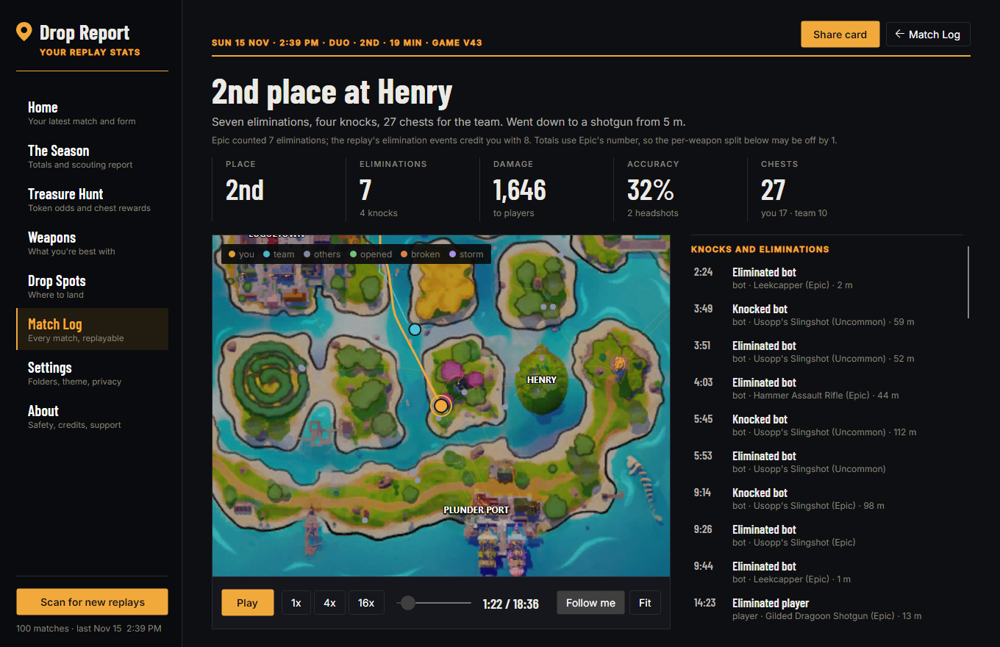
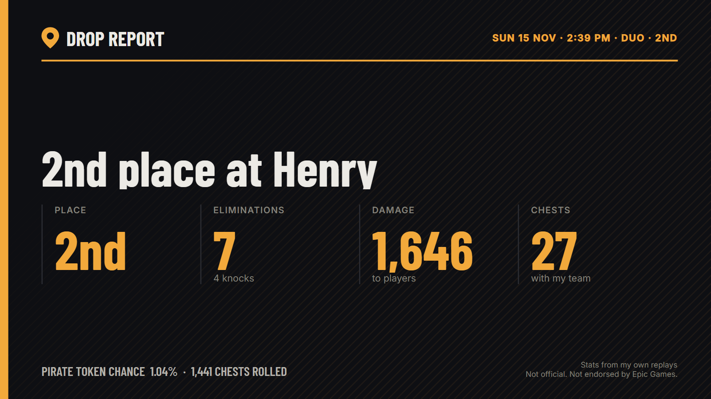

<p align="center"></p>

<h1 align="center">Drop Report</h1>

<p align="center"><b>Your Fortnite stats, the moment a match ends: what you're good at, where to drop, and your Pirate Shop token odds.</b><br>
Free and open source. Windows. Reads your own replay files; nothing leaves your PC.</p>



## What you get

- **A report card after every match.** Drop Report sits in the tray and reads each match as soon as it ends. A card
  slides into the corner (without stealing focus from the game): placement, eliminations, damage and chests against
  your usual, any new personal record, and how much your token chance moved.

  

- **Home.** Your latest match, today's session, a form guide of your last 10 placements, your last 10 against the rest
  of the season, personal records, and the one or two things to work on.
- **Treasure Hunt (season 43).** Your chance of having rolled the Pirate Shop token, from Epic's published per-chest
  odds; where your pace takes you by the season's end; chests needed for a 10/25/50% chance; Treasure Hours boosts; and
  the odds of the six other chest rewards. Nobody outside Epic knows whether refilled or broken chests roll, or whether
  a teammate's token reaches the squad, so those are switches: every number follows what you pick.
- **Weapons: what you're actually best with.** Most eliminations, most damage a match, best headshot rate, up close vs
  at range, against real players. Rankings need a minimum sample, so one lucky match can't top a list.
- **Drop spots.** Where you touched down every match, scored on placement, fights and loot, with the picks on a map.
- **Scouting report.** Strengths, weaknesses and tips drawn from your own numbers ("Shotguns win your fights", "Early
  fights are costing you", "Drop Loguetown for wins").
- **A playable map of every match** on the real island: your and your team's paths, the storm, every chest with what
  it dropped, every knock and elimination.
- **Share cards.** One click copies a good-looking image of a match or your season, ready to paste into Discord.
  Other players are never named on a card.

| Treasure Hunt | Weapons | Drop spots |
|---|---|---|
|  |  |  |

| Match replay | Share card |
|---|---|
|  |  |

## Safe by design

- **Reads files only.** Drop Report reads finished `.replay` files and, for item names, the game's own data files on
  disk. It never reads game memory, never injects anything and never touches the running game, which is what
  anti-cheat looks for.
- **Won't slow your game.** It reads replays at low priority and never while a match is being recorded. No admin
  rights. Starting with Windows is your choice (setup asks; Settings turns it off).
- **Private.** No account, no telemetry, no cloud. Your data stays in `%LOCALAPPDATA%\DropReport`. The only things it
  fetches on its own, each behind a switch in Settings, are the latest version number and the odds/Treasure Hours file
  from this repository ([data/treasure.json](data/treasure.json)), so odds can be corrected without a new release.
  A setting hides other players' names for screenshots and streams.

## Install

1. Download `DropReport.exe` from the [latest release](../../releases/latest). It is a single file; no installer, no
   .NET install needed.
2. In the game, make sure replays are on: **Settings > Game > Replays**, record replays for Battle Royale.
3. Run Drop Report. Setup walks you through:
   - **Real item names and the map (optional).** Replays only carry internal code names. Drop Report can read the real
     names, and where the map sits in the world, from your installed game's files. That needs a few small public
     downloads for your game version (a decryption key, a field-layout "mappings" file, the Oodle decompression
     library, and the map image with location names). The setup screen lists each one before anything is fetched.
     When Fortnite updates, Drop Report notices and offers to refresh them.
   - **Import.** It saves a copy of every replay (the game keeps only your last 100) and reads them, about a second
     per match.
4. Play. Each match shows up on its own.

## What replays can and can't tell you

Drop Report only knows what your replay recorded. Being upfront about the limits:

- **What you won isn't in replays.** Prizes are rolled and granted on Epic's servers. A replay can show the game's
  treasure chest appearing when a chest holding a treasure is opened or broken, but not the prize; your post-match
  "Treasures found" screen is the record. Token and reward odds are your chance, not a record of drops. Every treasure
  claim and its source: [docs/FINDINGS.md](docs/FINDINGS.md).
- **Team chests are a minimum.** A teammate far from you isn't in your replay.
- **Damage totals are partial.** Hits come through in detail for most guns, but slingshot hits arrive blank and melee
  items send none, so recorded damage is usually 50-60% of the game's own total. Headshot rate and per-hit damage are
  reliable. Match totals (eliminations, damage, accuracy) use Epic's own end-of-match numbers.
- **Eliminations follow Fortnite's own rule:** the player who knocked someone gets the elimination, whoever finishes
  them. Counted that way, the replay's elimination events match Epic's own count exactly in 94 of 100 test matches (the
  rest by one: a fight out of your view, or an unusual mode). The match page says when a match doesn't add up.
- **Quest progress, XP and map fragments aren't in replays.** They live on the game's servers.

Technical notes on how every number is decoded: [docs/FINDINGS.md](docs/FINDINGS.md).

## Build from source

Needs the .NET 10 SDK.

```
dotnet test
dotnet run --project src/DropReport.App
dotnet run --project src/DropReport.Cli -- analyze <replay file or folder> --out out
dotnet run --project src/DropReport.Cli -- insights 43
dotnet publish src/DropReport.App -c Release -r win-x64 --self-contained -p:PublishSingleFile=true -p:IncludeNativeLibrariesForSelfExtract=true -p:EnableCompressionInSingleFile=true -p:DebugType=none
```

Projects: `DropReport.ReplayReader` (replay reading + analysis; the assembly name must contain "ReplayReader" for the
parser to load its custom export classes), `DropReport.GameData` (item names from game files), `DropReport.App`
(Avalonia UI), `DropReport.Cli`, `tests/DropReport.Tests`.

## Support

Drop Report is free and stays free; nothing is locked behind a payment. If it helps you, you can
[sponsor development on GitHub](https://github.com/sponsors/JoshuaR06).

## Credits & license

MIT licensed. Built on [FortniteReplayReader](https://github.com/Shiqan/FortniteReplayDecompressor) (MIT),
[CUE4Parse](https://github.com/FabianFG/CUE4Parse) (Apache-2.0) and [Avalonia](https://github.com/AvaloniaUI/Avalonia)
(MIT); type is Barlow Condensed and Inter (SIL Open Font License). Reward odds are Epic's published figures (Fortnite
Status, 7 Nov 2026). See [THIRD-PARTY-NOTICES.md](THIRD-PARTY-NOTICES.md).

---

*Portions of the materials used are trademarks and/or copyrighted works of Epic Games, Inc. All rights reserved by
Epic. This material is not official and is not endorsed by Epic.* Drop Report is a fan-made tool and is not affiliated
with Epic Games.
